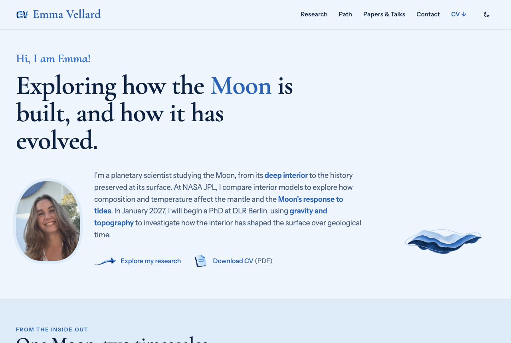
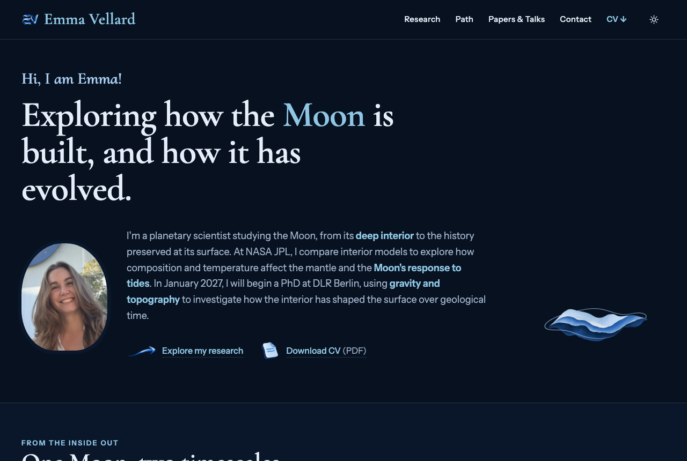
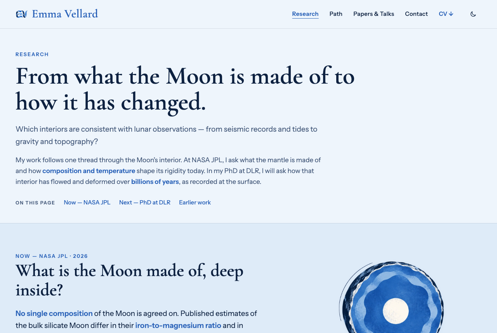
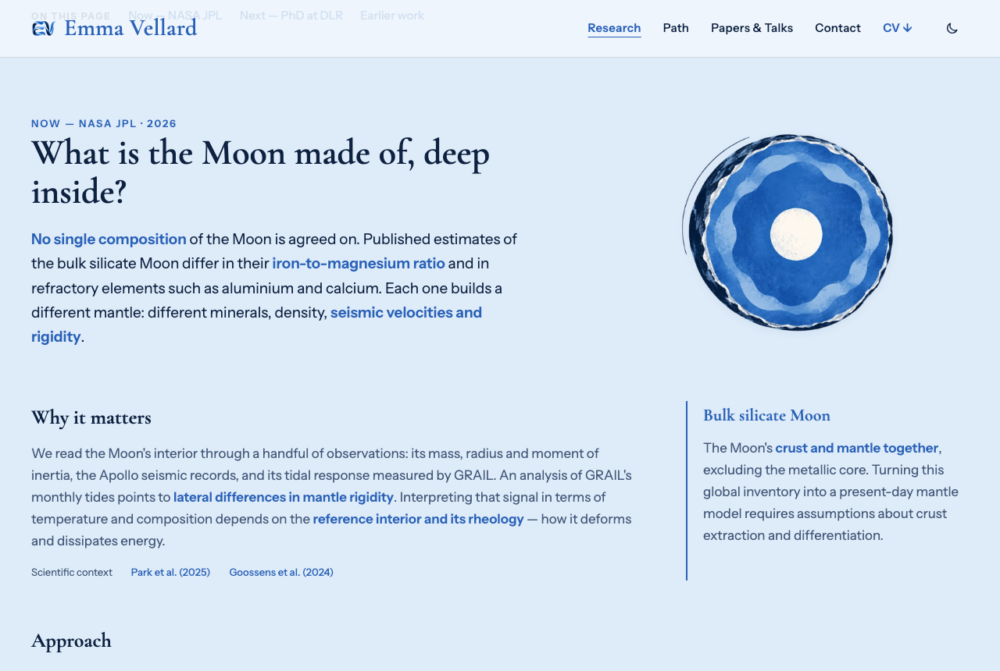
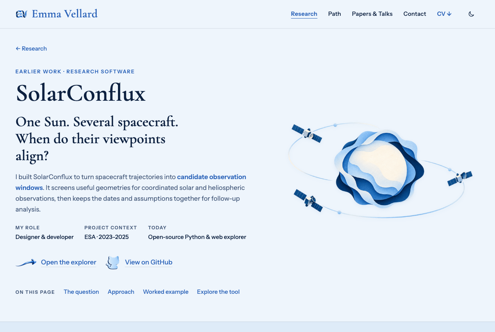
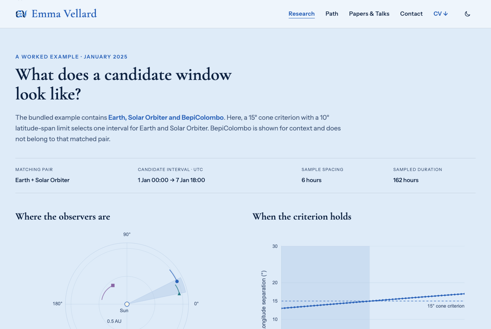

<h1 align="center">🌌 Emma Vellard — Planetary Science Portfolio</h1>

<p align="center">
  Portfolio of a planetary scientist and space systems engineer working across lunar science, scientific instrumentation, mission research, and scientific software.
</p>

<p align="center">
  <a href="https://www.emmavellard.com"><strong>Visit the live portfolio</strong></a>
</p>

## Preview

<p align="center">
  
  
</p>

<p align="center">
  
  
</p>

<p align="center">
  
  
</p>

## Scientific focus

- The Moon's interior: how bulk silicate Moon composition and temperature shape the mantle's mineralogy, density, seismic velocities and rigidity
- Interior models tested against mass, moment of inertia, Apollo seismic data and GRAIL's tidal response
- Lunar geodynamics from gravity and topography: maria, impact basins, ridges and rifts, mantle viscosity
- Reproducible scientific software for planetary modelling and observation planning

## Site sections

### Home — `/`

- **Introduction**: portrait, short bio and links to the research and CV
- **One Moon, two timescales**: the current NASA JPL work and the PhD at DLR, each asked as a question
- **The Moon, layer by layer**: a numbered cross-section (crust & surface, mantle, core) mapping where each project sits
- **Earlier work**: SolarConflux, Lunar Spaceport, YPSat, Phobos & Deimos, Diplona
- **Path**: institution, role and country, from DLR to the degrees in France and South Korea
- **Papers & talks**: papers in preparation, then talks and posters
- **Contact**: in the footer, on every page

### Research — `/research`

A continuous story in two chapters, alternating with the tinted background used on the home page:

- **Now — NASA JPL (2026)**: what the Moon is made of, deep inside; why it matters, the four-step approach (compositions → mineralogy & properties → interior models → tidal response), status and tools
- **One interior, different timescales**: the link between today's rigidity and the interior's evolution
- **Next — PhD at DLR Berlin (January 2027)**: how the interior has shaped the surface; planned research threads (maria, basins, ridges & rifts, mantle)
- **Earlier work**: links to each project page

### Projects — `/projects/*`

- **SolarConflux** (`/projects/solarconflux`): the question, approach, six screening geometries, a worked January 2025 example with downloadable samples and provenance, and the current web explorer
- **Lunar Spaceport**, **YPSat**, **Phobos & Deimos**, **Diplona**: shared template with the question, what I did, what came out, figures and technical details

Every project page links to the previous and next project, in the same order as the home page.

Old URLs (`/experience`, `/education`, `/conferences`, `/about`, `/contact`, `/projects`) redirect to the matching section (see `vercel.json`).

Screenshots live in `docs/screenshots/` and are not published with the site.

## Technology

- [Astro](https://astro.build/) with static site generation
- Custom responsive CSS with light and dark themes, accessible navigation and transparent hand-drawn illustrations
- Vercel Analytics and Speed Insights
- Open Graph metadata, sitemap, and search-engine indexing support

## Local development

Use Node.js 22.12 or newer (the repository includes an `.nvmrc` file).

```sh
npm install
npm run dev
```

Create a production build with:

```sh
npm run build
```

Run the full local quality suite with:

```sh
npx playwright install chromium
npm run quality
```

The quality suite checks formatting and Astro types, validates the generated pages and internal links, and runs browser interaction tests.

## Deployment

The portfolio is deployed on Vercel at [www.emmavellard.com](https://www.emmavellard.com).

## License

This repository is for personal portfolio use. Content and design © Emma Vellard.
